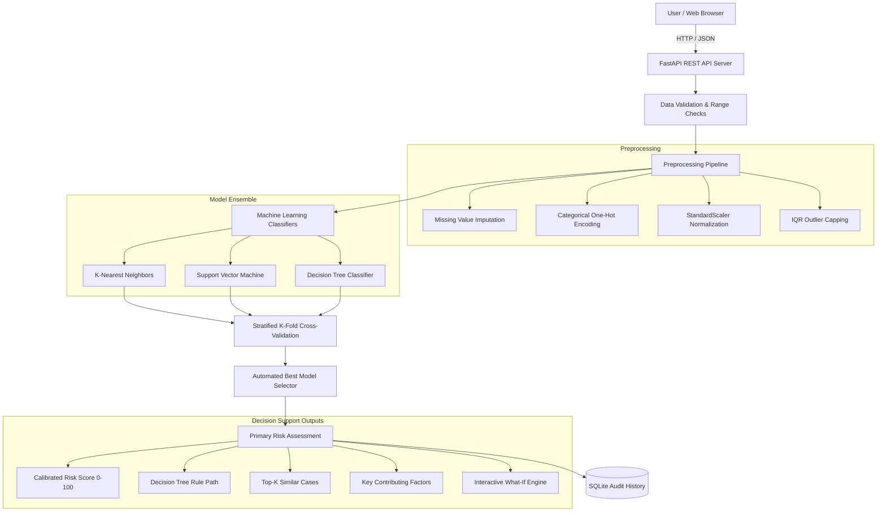

# Intelligent Decision Support System for Risk Assessment Using Machine Learning

[](https://www.python.org/)
[](https://fastapi.tiangolo.com/)
[](https://scikit-learn.org/)
[](https://react.dev/)
[](https://vitejs.dev/)
[]()

> A generic, machine-learning-based risk assessment and decision-support platform designed to evaluate multidimensional risk scenarios across financial, operational, cybersecurity, environmental, business, safety, project, and infrastructure domains.

---

## 1. Project Overview & Scope

Traditional risk management frameworks often rely on static heuristic lookups or subjective scoring matrices. This project implements a **comprehensive, evidence-backed Decision Support System (DSS)** that combines statistical machine learning classifiers with rigorous preprocessing, stratified cross-validation, mathematical explainability, similar case retrieval, and what-if perturbation simulations.

### Key Analytical Deliverables:
- **Multi-Class Risk Classification:** `LOW`, `MEDIUM`, and `HIGH` risk categorizations.
- **Calibrated Quantitative Risk Score (0–100):** Mathematically derived continuous index based on model-calibrated class probability vectors.
- **Multi-Model Consensus Engine:** Independent parallel inference across **K-Nearest Neighbors (KNN)**, **Support Vector Machines (SVM)**, and **Decision Tree Classifiers**.
- **Model Explainability & Decision Paths:** Step-by-step logical rule traversal extracting the exact split thresholds and conditions evaluated by the decision tree.
- **Top Contributing Risk Factors:** Analytical identification of escalating drivers, mitigating safeguards, and critical vulnerabilities.
- **Nearest Case Retrieval:** Top-5 nearest historical cases retrieved from the historical case library using Euclidean/Cosine distance metrics with percentage similarity scores.
- **Interactive What-If Sensitivity Simulator:** Real-time dual slider workbench comparing baseline and modified risk scenarios with score deltas and probability vector shifts.
- **Model Benchmarking & Cross-Validation:** Stratified 5-Fold Cross-Validation telemetry reporting mean accuracy, macro F1-score, precision, recall, standard deviation variance ($\sigma$), and interactive confusion matrix heatmaps.
- **Persistent Assessment Audit Log:** SQLite database storing predictions, features, timestamps, notes, and CSV export capabilities.

---

## 2. System Architecture



---

## 3. Core Machine Learning Modules

### A. K-Nearest Neighbors (KNN)
- **Hyperparameters:** Configurable $K$ ($1 \le K \le 15$), Distance Metrics (Euclidean, Manhattan $L_1$, Cosine), and Distance-Weighted voting.
- **Precedent Retrieval:** Identifies the $K$ most similar historical cases in the transformed feature space:
  $$\text{Euclidean Similarity } (\%) = \left(\frac{1}{1 + d(x, x_i)}\right) \times 100$$

### B. Support Vector Machine (SVM)
- **Kernels:** Radial Basis Function (RBF), Linear, and 3rd-Degree Polynomial.
- **Regularization ($C$):** Soft-margin optimization balancing training margin width and slack penalties.
- **Probability Calibration:** Platt scaling / cross-validated probability calibration for authentic confidence vectors.
- **2D Boundary Visualizer:** Generates continuous decision boundary meshgrids projecting two selected attributes while holding other features at their population means.

### C. Decision Tree Classifier
- **Splitting Criteria:** Gini Impurity and Information Gain (Entropy):
  $$\text{Gini} = 1 - \sum_{i=1}^C p_i^2 \quad \Big| \quad \text{Entropy} = -\sum_{i=1}^C p_i \log_2(p_i)$$
- **Tree Depth & Pruning:** Configurable `max_depth` and `min_samples_split` to prevent overfitting.
- **Rule Path Extractor:** Traverses internal node indicators to output transparent human-readable explanations (e.g., `Severity (7.8) > 6.2 -> Control_Effectiveness (3.5) <= 4.1 -> High Risk`).

---

## 4. Quantitative Risk Scoring Methodology

Rather than generating arbitrary random numbers, the system computes a **mathematically grounded 0–100 continuous Risk Score** using the model's calibrated class probability distribution:

$$\text{Risk Score} = \big(P(\text{Low}) \times 15.0\big) + \big(P(\text{Medium}) \times 55.0\big) + \big(P(\text{High}) \times 95.0\big)$$

- **Bounded:** Guaranteed to span $[0.0, 100.0]$.
- **Continuous & Differentiable:** Reflects subtle changes in input characteristics during What-If sensitivity simulations.

---

## 5. Input Feature Definitions

| Feature | Description | Allowed Range | Default |
| :--- | :--- | :---: | :---: |
| **Category** | Domain Scope (Financial, Cyber, Operational, Safety, etc.) | Categorical | `Cybersecurity` |
| **Severity** | Potential magnitude of consequences if event occurs | 1.0 – 10.0 | 5.0 |
| **Likelihood** | Probability or frequency of the risk event manifesting | 1.0 – 10.0 | 5.0 |
| **Exposure** | Degree to which assets and operations are exposed | 1.0 – 10.0 | 5.0 |
| **Frequency** | Recurrence rate of triggering conditions | 1.0 – 10.0 | 4.0 |
| **Duration** | Expected downtime, recovery latency, or persistence | 1.0 – 10.0 | 4.0 |
| **Impact** | Collateral consequence on revenue, operations, or reputation | 1.0 – 10.0 | 5.0 |
| **Historical Occurrence** | Count of prior incidents within the past 3 years | 0.0 – 10.0 | 2.0 |
| **Control Effectiveness** | Strength of preventive safeguards and mitigation controls | 1.0 – 10.0 | 6.0 |

---

## 6. Installation & Execution Guide

### Prerequisites
- Python 3.10+ (Tested on Python 3.12)
- Node.js 18+ & npm

### Option 1: One-Click Launch (Windows)
Double-click `start_all.bat` or run:
```cmd
start_all.bat
```

### Option 2: Manual Step-by-Step Launch

#### 1. Backend Server (FastAPI)
```bash
# Navigate to project directory
cd "mds cbp"

### Unified Single-Service Deployment (Recommended)

You can run and deploy both the React frontend and FastAPI backend together on a single port:

```bash
# 1. Install dependencies
pip install -r requirements.txt
cd frontend && npm install && npm run build && cd ..

# 2. Run unified server
python run.py
```
- **Unified Web Application UI**: `http://localhost:8000`
- **Interactive OpenAPI Docs**: `http://localhost:8000/docs`

#### Cloud Deployment (Render / Railway / Heroku / HuggingFace)
- **Build Command**: `bash build.sh` (or `pip install -r requirements.txt && cd frontend && npm install && npm run build && cd ..`)
- **Start Command**: `uvicorn app:app --app-dir backend --host 0.0.0.0 --port $PORT`
- **Docker**: `docker build -t risk-dss . && docker run -p 8000:8000 risk-dss`

---

### Separate Development Mode (Optional)

#### 1. Backend Server (FastAPI)
```bash
python backend/app.py
```
- API Base: `http://127.0.0.1:8000`

#### 2. Frontend Hot-Reload Server (React + Vite)
```bash
cd frontend
npm run dev
```
- Web Application UI: `http://localhost:5173`

---

## 7. Step-by-Step Academic Demonstration Flow

During a project demonstration or viva, follow this 6-step presentation flow:

1. **Dashboard Overview:**
   - Introduce the generic risk problem statement and multi-domain scope.
   - Showcase dataset metrics (1,200 historical cases) and baseline model leaderboard.
2. **Dataset & Data Quality Inspection:**
   - Navigate to **Dataset & Quality**.
   - Show missing-value audits, IQR outlier statistics, and feature correlations.
3. **Model Evaluation & Cross-Validation:**
   - Navigate to **Model Evaluation**.
   - Review 5-Fold Stratified Cross-Validation fold-by-fold telemetry, standard deviations ($\sigma$), and confusion matrices.
   - Demonstrate the **Retraining Workbench** (e.g. switch SVM kernel from RBF to Linear or change KNN distance metric).
4. **Primary Risk Assessment:**
   - Navigate to **Risk Assessment**.
   - Load a benchmark preset (e.g., *Cyber Ransomware Attack*).
   - Click **Generate Comprehensive Risk Assessment**.
5. **Explainability & Precedent Retrieval:**
   - On the **Assessment Result** page, review the 0–100 Risk Score Gauge, multi-model consensus, analytical contributing factors, decision tree rule path, and Top-5 similar historical cases.
6. **What-If Sensitivity Simulation:**
   - Click **Launch What-If Simulation**.
   - Increase *Control Effectiveness* from 4.0 to 8.5 to observe the live score reduction and probability shift.
   - Show the analytical commentary and delta comparison.

---

## 8. System Disclaimers & Constraints

- **Decision-Support Scope:** This system is an analytical decision-support tool created for academic evaluation. It augments human subject-matter experts with machine learning probabilities and transparent reasoning, but is not an autonomous legal, financial, or safety certifying entity.
